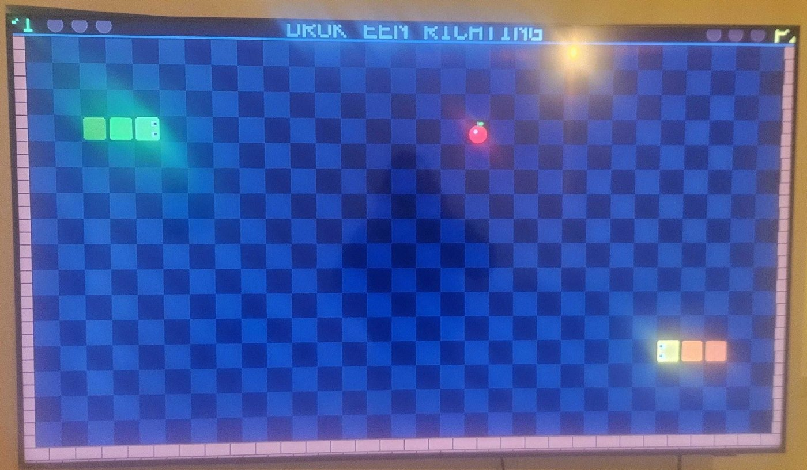
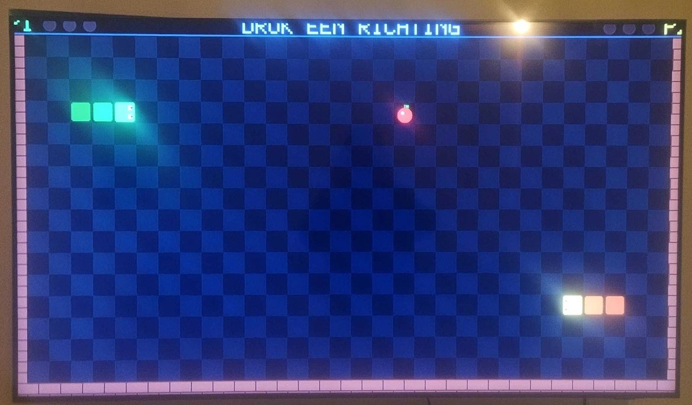
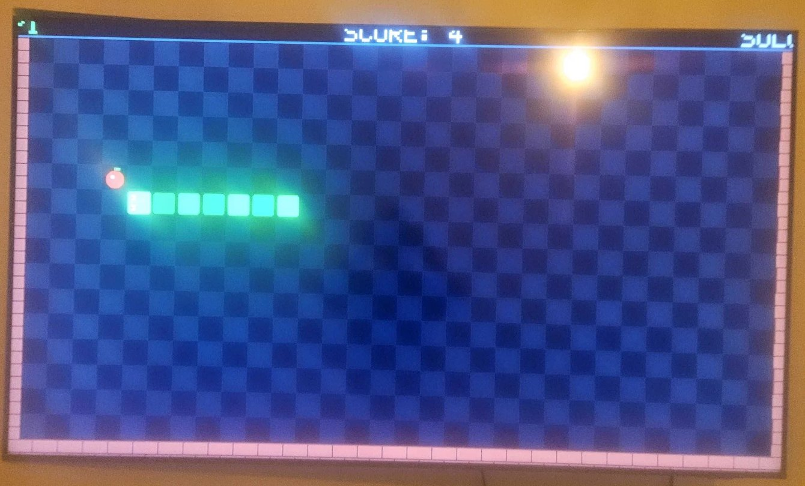

# PYNQ2-Snake – HDMI/UDP Snake op de PYNQ-Z2



*Het spel draait op de PYNQ-Z2. Speler 1 (groen) en speler 2 (oranje) worden via UDP bestuurd, en het beeld komt via HDMI uit de programmable logic.*

## Beschrijving

Een IoT-platform op een **PYNQ-Z2** (Zynq-7000) dat een Snake-spel voor één of twee spelers toont op een **HDMI-scherm**. De spelers sturen hun slang aan via **twee UDP-verbindingen**, elk vanaf een eigen toestel: een laptop, of later een ander PYNQ-board.

- De **Processing System (PS)**, een ARM Cortex-A9, draait **FreeRTOS** met **lwIP**. Die ontvangt de UDP-pakketten en voert de spellogica uit in aparte taken.
- De **Programmable Logic (PL)** maakt het HDMI-beeld: een AXI VDMA leest de framebuffer uit DDR, de VTC maakt de video-timing, en `rgb2dvi` doet de TMDS-encoding.

### Vereisten van de opdracht

| Vereiste | Invulling | Status |
|---|---|---|
| Ontwikkeld op een PYNQ-board | PYNQ-Z2 (xc7z020clg400-1) | ✅ |
| HDMI via de programmable logic | AXI VDMA + VTC + AXI4-Stream to Video Out + Digilent `rgb2dvi` in de PL | ✅ |
| 2 UDP-communicaties | lwIP-sockets op poort **5000** (speler 1) en **5001** (speler 2) | ✅ |
| FreeRTOS | `freertos10_xilinx` met 3 taken + een queue | ✅ |
| *Nice-to-have:* 2 verschillende devices | elke speler draait de controller op een eigen laptop | ✅ (getest met 2 controllers) |
| *Nice-to-have:* andere PYNQ-boards | controller-boards sturen UDP via de knoppen op het board | ⏳ fase 4 |

## Het spel

| Scherm | Wat je ziet |
|---|---|
| **Menu** | Titel "SNAKE" met twee keuzevakken: **1 SPELER** (Q of 1) en **2 SPELERS** (D of 2) |
| **Wachtscherm** (2 spelers) | Per speler "VERBONDEN" of "WACHTEN...". **Het spel start pas als beide spelers verbonden zijn.** |
| **Speelveld** | Een dambord-achtergrond, bakstenen muren, slangen met een kop met oogjes, appels, en bovenaan een scorebalk |
| **Einde** | "SPELER 1 WINT!" (2 spelers), of "GAME OVER" met je score (solo) |

**Spelregels**
- **Appel eten**: +1 punt, je wordt 1 cel langer en **je slang draait om**: de kop wordt de staart en je gaat de andere kant op. Daarna sta je 0,3 s stil, zodat je kunt reageren.
- **2 spelers**: wie eerst **3 appels** heeft, wint. Bots je, dan verdwijn je ongeveer 1 s en kom je terug op je startplek. Je punten blijf je houden.
- **1 speler**: haal zoveel appels als je kunt. Bots je, dan is het game over.
- **N** brengt je altijd terug naar het menu.

### UDP-protocol
Eén ASCII-teken per pakket. Meerdere tekens in één pakket mag ook.

| Teken | Betekenis | Antwoord |
|---|---|---|
| `U` `D` `L` `R` | richting omhoog / omlaag / links / rechts | `OK` |
| `1` `2` | in het menu: 1 of 2 spelers | `OK` |
| `N` | terug naar het menu | `OK` |
| `J` | heartbeat "ik ben verbonden". De controller stuurt dit elke seconde. | geen |
| `X` | afmelden | geen |

Krijgt het board langer dan **3 s** niets van een speler, dan geldt die speler als weg. Met 2 spelers gaat het spel dan terug naar het wachtscherm.

### Controller (pc)
[`tools/udp_controller.py`](tools/udp_controller.py) is een Python-script voor Windows (AZERTY):

| Toets | Actie |
|---|---|
| **Z / Q / S / D** of de pijltjes | omhoog / links / omlaag / rechts |
| **1 / 2** (of `&` / `é`) | in het menu: 1 of 2 spelers |
| **N** | menu |
| **Esc** | stoppen en afmelden |

```powershell
python tools/udp_controller.py 192.168.0.196 5000
```
```powershell
python tools/udp_controller.py 192.168.0.196 5001
```

Het eerste commando is voor speler 1, het tweede voor speler 2. Gebruik het IP-adres dat het board op de UART toont (`Board IP:`).

### Sequence of operation

1. Verbind de PYNQ-Z2 via micro-USB met de pc. Zet de boot-jumper op **JTAG** en de power-jumper op **USB**.
2. Sluit een monitor aan op **HDMI OUT**, en een ethernetkabel op een **LAN-poort** van de router (niet de WAN/Internet-poort).
3. Start `snake_app` vanuit Vitis. De seriële terminal (115200 baud) toont het IP-adres van het board.
4. Het scherm toont het **menu**.
5. Start op elke laptop de controller met het IP van het board. Kies 1 of 2 spelers en speel.

## Architectuur

### Hardware (PL)
```
            ┌──────────── Zynq PS (ARM Cortex-A9) ────────────┐
            │  FreeRTOS + lwIP, framebuffer fb[] (DDR, 2,7 MB) │
            │  GEM0 ethernet ◄──► router (UDP 5000 / 5001)    │
            │  TTC0 = FreeRTOS tick-timer                      │
            └───┬──────────────────────────────▲──────────────┘
     M_AXI_GP0  │ AXI-Lite (registers)         │ S_AXI_HP0 (64-bit, DDR lezen)
                ▼                              │
            AXI SmartConnect ──► AXI VDMA (MM2S) ─┘
                                     │ AXI4-Stream, 24-bit RGB
Video Timing Controller ──► AXI4-Stream to Video Out ──► rgb2dvi ──► HDMI OUT
Clocking Wizard: FCLK_CLK0 100 MHz → 74,25 MHz pixelklok (720p60), alles in één klokdomein
```

| Adres | Blok | Gebruikt door |
|---|---|---|
| `0x4300_0000` (64K) | `axi_vdma_0` registers (S_AXI_LITE) | CPU via M_AXI_GP0 |
| `0x0000_0000` – `0x1FFF_FFFF` | DDR (HP0_DDR_LOWOCM) | VDMA via S_AXI_HP0 |

**Pixelformaat**: 3 bytes per pixel, in het geheugen in de volgorde **G, B, R** (Xilinx AXI4-Stream video + Digilent rgb2dvi). Pixel (x, y) staat op `fb[y*3840 + x*3]`. Na het tekenen moet de D-cache geflusht worden (`Xil_DCacheFlushRange`), anders ziet de VDMA de nieuwe pixels niet.

### Software (FreeRTOS)
```
 Laptop 1 ──UDP:5000──┐                     ┌──────────────── FreeRTOS ─────────────────┐
                      ├─► GEM0 ─► lwIP ────►│ udp_task(P1) ─┐                            │
 Laptop 2 ──UDP:5001──┘                     │ udp_task(P2) ─┴─► queue ─► game_task (150 ms) ─► fb[] ─► VDMA ─► HDMI
                                            │   └─ last_seen[] (heartbeat / verbonden?)  │
                                            └────────────────────────────────────────────┘
```

| Taak | Functie |
|---|---|
| `main_thread` (template) | start lwIP en ethernet, doet DHCP (met fallback naar een vast IP), roept `start_application()` aan |
| `udp_task` ×2 | een socket per speler (poort 5000/5001). Werkt `last_seen` bij, zet commando's in de queue en antwoordt `OK` |
| `game_task` | elke 150 ms (`vTaskDelayUntil`): leest de queue, beheert menu / wachtscherm / spel, beweegt de slangen en tekent alleen de veranderde cellen |

Het speelveld is een raster van 32×18 cellen van 40×40 px. Rij 0 is de scorebalk. Tekst wordt getekend met een eigen 5×7-pixel-lettertype in `snake.c`.

## Materialen en methodes

- **Hardware**: PYNQ-Z2, HDMI-monitor, micro-USB-kabel, ethernetkabel, thuisrouter
- **FPGA-design**: AMD Vivado 2026.1 (IP Integrator, block design)
- **Firmware**: AMD Vitis 2026.1 (Unified IDE, SDT-flow), C, FreeRTOS 10 + lwIP 2.2 (`lwip220`, socket-API)
- **Controller**: Python 3 (alleen de standaardbibliotheek)
- **Externe IP**: [Digilent vivado-library](https://github.com/Digilent/vivado-library) (`rgb2dvi`)
- **Methode**: in fases bouwen en elke fase eerst op het board testen:
  1. TPG → HDMI
  2. VDMA-framebuffer
  3. FreeRTOS + UDP + spel

## Projectstructuur

```
snake_UDP_FREErtos/
├── snake_UDP_FREErtos.xpr          Vivado-project
├── snake_UDP_FREErtos.srcs/        block design (design_1.bd) + IP-configuratie (.xci)
├── constraints/hdmi_pynq_z2.xdc    HDMI TX-pinnen (uit de PYNQ-Z2 master XDC)
├── test_wrapper.xsa                hardware-export fase 1 (TPG)
├── fase2_vdma.xsa                  hardware-export fase 2 (VDMA)
├── fase3_rtos.xsa                  hardware-export fase 3 (VDMA + TTC0 voor FreeRTOS), incl. bitstream
└── vitis_workspace/                oude workspace: fase 1 (hdmi_app) en fase 2 (vdma_app)
ws/                                 korte workspace voor fase 3 (zie "Wat ging er mis")
├── pynq_rtos_plat/                 Vitis-platform uit fase3_rtos.xsa, domain freertos_ps7_cortexa9_0
└── snake_app/src/
    ├── main.c                      netwerk-opstart (template, DHCP-fallback 192.168.0.200, 30 s)
    └── snake.c                     het spel: VDMA, UDP-taken, game-taak, graphics
tools/udp_controller.py             controller voor de pc (AZERTY + heartbeat)
```

Build-output (`*.runs`, `*.gen`, `*.cache`, Vitis `build/`, gegenereerde platformbestanden) en `vivado-library-master` staan niet in git, zie `.gitignore`.

## Aan de slag

### Benodigdheden
1. **Vivado + Vitis 2026.1**
2. **PYNQ-Z2 board files**: kopieer de map `pynq-z2` naar
   `<install>\Vivado\2026.1\data\xhub\boards\XilinxBoardStore\boards\Xilinx\`
3. **Digilent vivado-library**: download de ZIP van GitHub en pak hem uit als
   `snake_UDP_FREErtos/vivado-library-master/`. Het project verwijst naar dat pad.
4. **Fix voor lwip220 in Vitis 2026.1**: voer dit één keer uit in een PowerShell **als administrator** (zie "Wat ging er mis", probleem 7):
   ```powershell
   $f='C:\AMDDesignTools\2026.1\Vitis\data\embeddedsw\ThirdParty\sw_services\lwip220_v1_4\data\lwip220.yaml'; attrib -R $f; $b=[IO.File]::ReadAllBytes($f); if($b[0]-eq 0xEF){[IO.File]::WriteAllBytes($f,$b[3..($b.Length-1)])}; attrib +R $f
   ```

### Hardware bouwen (Vivado)
1. Open `snake_UDP_FREErtos/snake_UDP_FREErtos.xpr`.
2. **Generate Bitstream**. Controleer daarna de timing (WNS ≥ 0, WHS ≥ 0).
3. **File → Export → Export Hardware** → *Include bitstream* → `fase3_rtos.xsa`.

### Software bouwen en draaien (Vitis)
1. Open Vitis → **Set Workspace** → `ws` (in de root van de repo, **kort pad!**).
2. Bestaat `pynq_rtos_plat` niet, maak het dan aan:
   - *New Component → Platform* met `fase3_rtos.xsa`, standalone, `ps7_cortexa9_0`.
   - Maak daarna de app via *Examples → FreeRTOS lwIP UDP Perf Server* met een nieuw domain `freertos_ps7_cortexa9_0` (OS freertos).
   - Vervang `udp_perf_server.c/.h` door `snake.c` uit de repo.
3. **Build** `snake_app`.
4. Board: jumper op **JTAG**, voeding op **USB**, HDMI in **HDMI OUT**, ethernet in een **LAN-poort** van de router.
5. Open de seriële monitor (115200 baud), klik op **Run** en noteer `Board IP:`.
6. Start de controller(s), zie [Controller (pc)](#controller-pc).

## Resultaten

- **Fase 1 ✅**: kleurbalken (TPG) op 1280×720 via HDMI vanuit de PL. Timing gehaald (WNS 4,337 ns, WHS 0,013 ns).
- **Fase 2 ✅**: de TPG is vervangen door een AXI VDMA die een framebuffer van 1280×720×3 bytes uit DDR leest. Een kleurtest bevestigt de bytevolgorde G-B-R. Timing gehaald (WNS 6,225 ns, WHS 0,039 ns).
  ```
  --- Fase 2: VDMA framebuffer naar HDMI ---
  Framebuffer op adres 0x0010C180 (2764800 bytes)
  VDMA draait. Kleurtest: rood-groen-blauw linksboven.
  ```
- **Fase 3 ✅**: FreeRTOS + lwIP op de PS, het board krijgt een IP via DHCP, en twee UDP-spelers besturen het spel met menu, wachtscherm, omdraaien en winnen. Getest met twee controllers.
  ```
  autonegotiation complete
  link speed for phy address 1: 1000
  DHCP request success
  Board IP:       192.168.0.196
  ========== PYNQ2-Snake ==========
  Speler 1: UDP poort 5000   Speler 2: UDP poort 5001
  ```
  Ping vanaf de pc: 4/4 antwoorden, ongeveer 3 ms.

### Foto's

| 2 spelers: klaar om te starten | 1 speler: in het spel (score 4) |
|---|---|
|  |  |
| Groene en oranje slang op hun startplek, een appel in het veld, en bovenaan "DRUK EEN RICHTING" met per speler 3 lege appel-vakjes | Solo-modus: de slang is gegroeid na 4 appels, en bovenaan staat "SCORE: 4" |

| Fase 2: VDMA-framebuffer (kleurtest + demo-slang) |
|---|
|  |

## Wat ging er mis (en hoe we het oplosten)

| # | Probleem | Oorzaak | Oplossing |
|---|---|---|---|
| 1 | De tutorial (Vivado/Vitis 2022.2) klopte niet meer met 2026.1 | Andere installatiepaden, nieuwe Vitis Unified IDE, SDT-flow | Stappen herschreven voor 2026.1 |
| 2 | *Make External* op de rgb2dvi `TMDS`-poort deed niets / *"Could not find tmds_rtl:1.0"* | Vivado kende de interface-definities van Digilent nog niet | Block design sluiten → `update_ip_catalog -rebuild` → opnieuw openen |
| 3 | `XPAR_V_TPG_0_DEVICE_ID undeclared` | Vitis 2024.1+ gebruikt de SDT-flow, zonder `DEVICE_ID`-macro's | `XV_tpg_Initialize(&tpg, XPAR_XV_TPG_0_BASEADDR)`, met `#ifdef SDT` voor beide versies |
| 4 | De standaard Vitis-voorbeelden (Hello World…) waren niet zichtbaar | Er was geen workspace ingesteld ("undefined" in de statusbalk) | *File → Set Workspace* |
| 5 | Validatiefout **BD 41-758**: `m_axis_mm2s_aclk` heeft geen klok | *Run Connection Automation* verbindt die VDMA-klok niet | Met de hand aan `clk_out1` gehangen |
| 6 | Na het verwijderen van de TPG werkte de oude app niet meer | De hardware veranderde (andere `.xsa`) | Per fase een eigen `.xsa`, platform en app |
| 7 | **`Couldn't find the src directory for lwip220`** | **Bug in Vitis 2026.1**: `lwip220.yaml` begint met een UTF-8-BOM. Vitis leest het bestand met de Windows-codering, en daardoor komt lwip220 niet in de library-index (`_ide/.wsdata/.repo.yaml`). | De BOM verwijderd met admin-PowerShell (het bestand is ook *alleen-lezen*), en lwip220 opnieuw in de `.repo.yaml` van de workspace gezet |
| 8 | *"Domain ... already exists"* terwijl het domain niet bestond | De Vitis-server onthoudt mislukte domains in zijn geheugen. Venster sluiten is niet genoeg, want de `java`-processen blijven draaien. | Een andere domain-naam of een nieuw platform, of alle Vitis-processen stoppen |
| 9 | *"freertos10_xilinx requires at least one timer hardware instance"* | FreeRTOS gebruikt in de SDT-flow een **TTC** als tick-timer, en de PYNQ-Z2-preset zet TTC0 uit | In Vivado: Zynq PS → MIO Configuration → **Timer 0** aan → nieuwe bitstream → `fase3_rtos.xsa` |
| 10 | Platform-build faalt: *"opening dependency file … .obj.d: No such file or directory"* | **Windows-padlimiet (260 tekens)**: de FreeRTOS/lwIP-objectbestanden kwamen op ongeveer 250 tekens in `snake_UDP_FREErtos\vitis_workspace\…` | Nieuwe korte workspace `ws\` in de repo-root (39 in plaats van 71 tekens) |
| 11 | DHCP time-out, geen ping (*Destination host unreachable*) | De ethernetkabel zat in de **WAN/Internet-poort** van de router, en het fallback-IP (192.168.1.10) zat in een ander subnet dan de pc (192.168.0.x) | De kabel in een **LAN-poort** → DHCP lukt (192.168.0.196). Fallback-IP aangepast naar 192.168.0.200 en de DHCP-wachttijd naar 30 s. |
| 12 | `can't open file 'C:\Users\...\tools\udp_controller.py'` | Het script werd gestart vanuit de verkeerde map | Het volledige pad gebruiken, of eerst `cd` naar de repo |

## Discussie

**Wat werkt al?**

- [x] HDMI-uitgang via de PL (720p)
- [x] Eigen beeld via VDMA + framebuffer in DDR
- [x] FreeRTOS + lwIP, 2 UDP-poorten
- [x] Snake-spel: menu, 1/2 spelers, wachtscherm tot beide verbonden zijn, omdraaien bij een appel, eerste tot 3 wint
- [x] Twee verschillende devices als controller
- [ ] Controller-boards (andere PYNQ's) als UDP-zender

**Komende stappen**

1. **Fase 4**: een tweede en derde PYNQ-board als controller. Die lezen de knoppen uit en sturen `U/D/L/R` + een heartbeat `J` via UDP.
2. Eventueel *double buffering* (3 frame stores in de VDMA staan al klaar) tegen tearing.
3. De scorebalk iets lager zetten, zodat hij ook op tv's met overscan volledig zichtbaar is.

**Bekende beperkingen**

- UDP heeft geen echte verbinding. "Verbonden" betekent: de laatste 3 s een pakket ontvangen. Een eigen zender (bijvoorbeeld een PYNQ-board) moet dus ook elke seconde `J` sturen.
- Iedereen in het netwerk kan naar poort 5000/5001 sturen. Er is geen authenticatie.
- Het IP-adres komt van DHCP en kan veranderen. Kijk altijd naar `Board IP:` op de UART.
- Op een tv valt de bovenkant van de scorebalk soms net buiten beeld (**overscan**, zie de foto's). Zet de beeldgrootte van de tv op *Schermvullend / Just Scan / 1:1*, of gebruik een pc-monitor.
- De kleuren op de foto's zijn blauwer en feller dan in de code (donkergrijs dambord, bruine bakstenen). Dat komt door de beeldmodus van de tv en de camera.

## Documentatie

- [Design Document](./docs/design.md)
- [User Manual](./docs/user-manual.md)

## Personen

- Student 1 [@username](https://github.com/student1)
- Student 2 [@username](https://github.com/student2)
