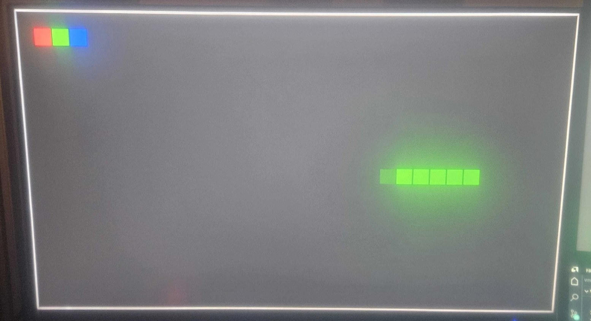

# PYNQ2-Snake – HDMI/UDP Snake op de PYNQ-Z2



*Fase 2: de CPU tekent in een framebuffer in DDR, de AXI VDMA in de PL zet het beeld op HDMI (kleurtest + bewegende demo-slang).*

## Beschrijving

Een IoT-platform op een **PYNQ-Z2** (Zynq-7000) dat een Snake-spel voor twee spelers toont op een **HDMI-scherm**. De spelers sturen hun slang aan via **twee UDP-verbindingen**, elk vanaf een eigen toestel (laptop of een ander PYNQ-board).

- De **Processing System (PS)**, een ARM Cortex-A9, draait **FreeRTOS** met lwIP. Die ontvangt de UDP-pakketten en voert de spellogica uit.
- De **Programmable Logic (PL)** maakt het HDMI-beeld: video-timing, AXI4-Stream naar video en TMDS-encoding.

### Vereisten van de opdracht

| Vereiste | Invulling |
|---|---|
| Ontwikkeld op een PYNQ-board | PYNQ-Z2 (xc7z020clg400-1) |
| HDMI via de programmable logic | VTC + AXI4-Stream to Video Out + Digilent `rgb2dvi` in de PL |
| 2 UDP-communicaties | lwIP-sockets op poort 5000 (speler 1) en 5001 (speler 2) |
| FreeRTOS | `freertos` domain in Vitis |
| *Nice-to-have:* 2 verschillende devices | elke speler stuurt vanaf een eigen toestel |
| *Nice-to-have:* andere PYNQ-boards | controller-boards sturen UDP via de knoppen op het board |

### Sequence of operation

1. Verbind de PYNQ-Z2 via micro-USB met de pc. Zet de boot-jumper op JTAG en de power-jumper op USB.
2. Sluit een monitor aan op **HDMI OUT**.
3. Start de applicatie vanuit Vitis. De seriële terminal (115200 baud) toont een opstartbericht.
4. Het scherm toont het speelveld *(fase 2: grijs veld met witte rand, kleurtest en een bewegende demo-slang)*.
5. De spelers sturen `U`/`D`/`L`/`R` via UDP naar het board *(fase 3)*.

## Architectuur

```
            ┌──────────── Zynq PS (ARM Cortex-A9) ────────────┐
            │  CPU tekent in framebuffer fb[] (DDR, 2,7 MB)   │
            └───┬──────────────────────────────▲──────────────┘
     M_AXI_GP0  │ AXI-Lite (registers)         │ S_AXI_HP0 (64-bit, DDR lezen)
                ▼                              │
            AXI SmartConnect ──► AXI VDMA (MM2S) ─┘
                                     │ AXI4-Stream, 24-bit RGB
Video Timing Controller ──► AXI4-Stream to Video Out ──► rgb2dvi ──► HDMI OUT
Clocking Wizard: FCLK_CLK0 100 MHz → 74,25 MHz pixelklok (720p60), alles in één klokdomein
```

| Adres | Blok | Gebruikt door |
|---|---|---|
| `0x4300_0000` (64K) | `axi_vdma_0` registers (S_AXI_LITE) | CPU via M_AXI_GP0 |
| `0x0000_0000` – `0x1FFF_FFFF` | DDR (HP0_DDR_LOWOCM) | VDMA via S_AXI_HP0 |

**Pixelformaat**: 3 bytes per pixel, in het geheugen in de volgorde **G, B, R** (Xilinx AXI4-Stream video + Digilent rgb2dvi). Pixel (x, y) staat op `fb[y*3840 + x*3]`. Na het tekenen moet de D-cache geflusht worden (`Xil_DCacheFlushRange`), anders ziet de VDMA de nieuwe pixels niet.

*Fase 1 (TPG-kleurbalken) staat in git op commit `5045eb4`.*

## Materialen en methodes

- **Hardware**: PYNQ-Z2, HDMI-monitor, micro-USB-kabel, ethernetkabel + switch
- **FPGA-design**: AMD Vivado 2026.1 (IP Integrator, block design)
- **Firmware**: AMD Vitis 2026.1 (Unified IDE), C, standalone → FreeRTOS + lwIP
- **Externe IP**: [Digilent vivado-library](https://github.com/Digilent/vivado-library) (`rgb2dvi`)

## Projectstructuur

```
snake_UDP_FREErtos/
├── snake_UDP_FREErtos.xpr          Vivado-project
├── snake_UDP_FREErtos.srcs/        block design (design_1.bd) + IP-configuratie (.xci)
├── constraints/hdmi_pynq_z2.xdc    HDMI TX-pinnen (uit de PYNQ-Z2 master XDC)
├── test_wrapper.xsa                hardware-export fase 1 (TPG)
├── fase2_vdma.xsa                  hardware-export fase 2 (VDMA), incl. bitstream
└── vitis_workspace/
    ├── pynq_hdmi_plat/             Vitis-platform fase 1 (uit test_wrapper.xsa)
    ├── hdmi_app/src/helloworld.c   fase 1: TPG-kleurbalken
    ├── pynq_vdma_plat/             Vitis-platform fase 2 (uit fase2_vdma.xsa)
    └── vdma_app/src/main.c         fase 2: framebuffer + VDMA + demo-slang
```

Build-output (`*.runs`, `*.gen`, `*.cache`, Vitis `build/`, enz.) en de `vivado-library-master` staan niet in git, zie `.gitignore`.

## Aan de slag

### Benodigdheden
1. **Vivado + Vitis 2026.1**
2. **PYNQ-Z2 board files**: kopieer de map `pynq-z2` naar
   `<install>\Vivado\2026.1\data\xhub\boards\XilinxBoardStore\boards\Xilinx\`
3. **Digilent vivado-library**: download de ZIP van GitHub en pak hem uit als
   `snake_UDP_FREErtos/vivado-library-master/`. Het project verwijst naar dat pad.

### Hardware bouwen (Vivado)
1. Open `snake_UDP_FREErtos/snake_UDP_FREErtos.xpr`.
2. **Generate Bitstream**. Controleer daarna dat de timing gehaald wordt (WNS ≥ 0).
3. **File → Export → Export Hardware** → *Include bitstream* → `fase2_vdma.xsa`.

### Software bouwen en draaien (Vitis)
1. Open Vitis → **Set Workspace** → `snake_UDP_FREErtos/vitis_workspace`.
2. Bouw het platform `pynq_vdma_plat` (Flow → Build). Bestaat het niet meer, maak het dan opnieuw aan: *New Component → Platform* met `fase2_vdma.xsa`, standalone, `ps7_cortexa9_0`.
3. Bouw `vdma_app` (Flow → Build).
4. Board: jumper op **JTAG**, voeding op **USB**, HDMI-kabel in **HDMI OUT**.
5. Open de seriële monitor (115200 baud) en klik op **Run**.

## Resultaten

- **Fase 1 ✅**: kleurbalken (TPG) op 1280×720 via HDMI vanuit de PL. Timing gehaald (WNS 4,337 ns, WHS 0,013 ns).
  UART-uitvoer:
  ```
  --- Fase 1: TPG naar HDMI ---
  TPG draait: kleurbalken op HDMI OUT
  ```
- **Fase 2 ✅**: de TPG is vervangen door een AXI VDMA die een framebuffer van 1280×720×3 bytes uit DDR leest. De CPU tekent zelf: een grijs veld met witte rand, een kleurtest (rood-groen-blauw, de bytevolgorde G-B-R klopt) en een demo-slang van 5 cellen (raster 32×18, cellen van 40 px) die elke 150 ms opschuift. Per stap worden alleen de veranderde cellen getekend en geflusht. Timing gehaald (WNS 6,225 ns, WHS 0,039 ns).
  UART-uitvoer:
  ```
  --- Fase 2: VDMA framebuffer naar HDMI ---
  Framebuffer op adres 0x0010C180 (2764800 bytes)
  VDMA draait. Kleurtest: rood-groen-blauw linksboven.
  ```
  *(foto: zie bovenaan deze README)*

## Discussie

**Wat werkt al?**

- [x] HDMI-uitgang via de PL (720p, TPG-kleurbalken)
- [x] Eigen beeld via VDMA + framebuffer in DDR
- [ ] FreeRTOS + lwIP, 2 UDP-poorten
- [ ] Snake-spellogica
- [ ] Controller-boards (andere PYNQ's) als UDP-zender

**Komende stappen**

1. **Fase 3**: `freertos`-domain met lwIP aan het platform toevoegen, UDP-taken op poort 5000/5001 en een game-taak (VDMA-code van fase 2 hergebruiken)
2. **Fase 4**: andere PYNQ-boards als controller

**Bekende bugs of beperkingen**

- Vivado 2026.1 vond de Digilent TMDS-interface pas na `update_ip_catalog -rebuild` (block design eerst sluiten).
- In Vitis 2026.1 verschijnen de embedded voorbeelden pas nadat er een workspace is ingesteld.
- Bij de VDMA verbindt *Run Connection Automation* `m_axis_mm2s_aclk` niet automatisch. Die moet je met de hand aan `clk_out1` hangen, anders geeft de validatie fout BD 41-758.
- Vitis 2026.1 werkt met de SDT-flow: drivers worden geïnitialiseerd met `XPAR_..._BASEADDR` in plaats van `..._DEVICE_ID`.

## Documentatie

- [Design Document](./docs/design.md)
- [User Manual](./docs/user-manual.md)

## Personen

- Student 1 [@username](https://github.com/student1)
- Student 2 [@username](https://github.com/student2)
